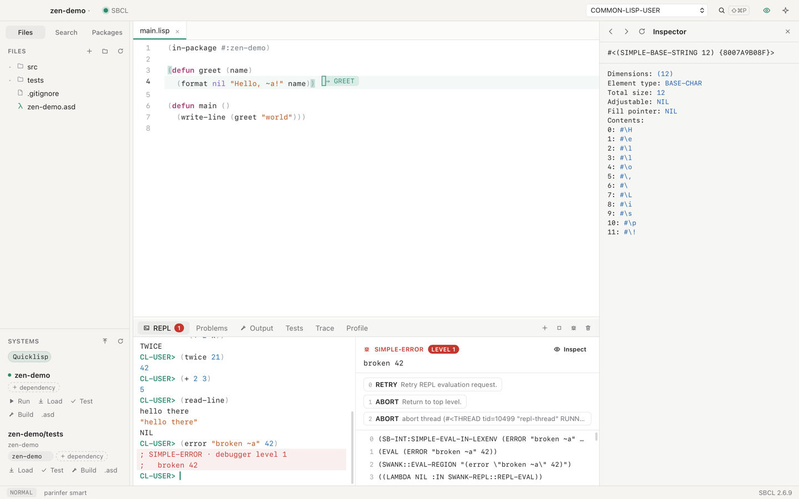
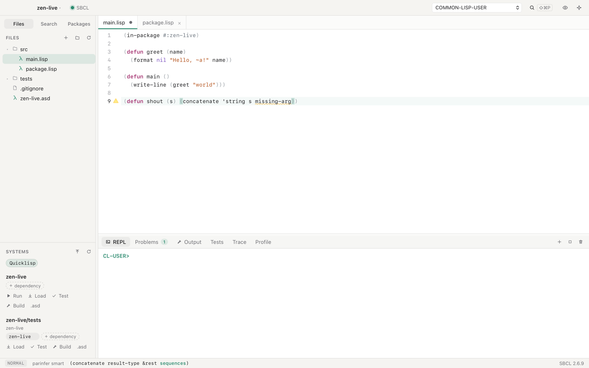
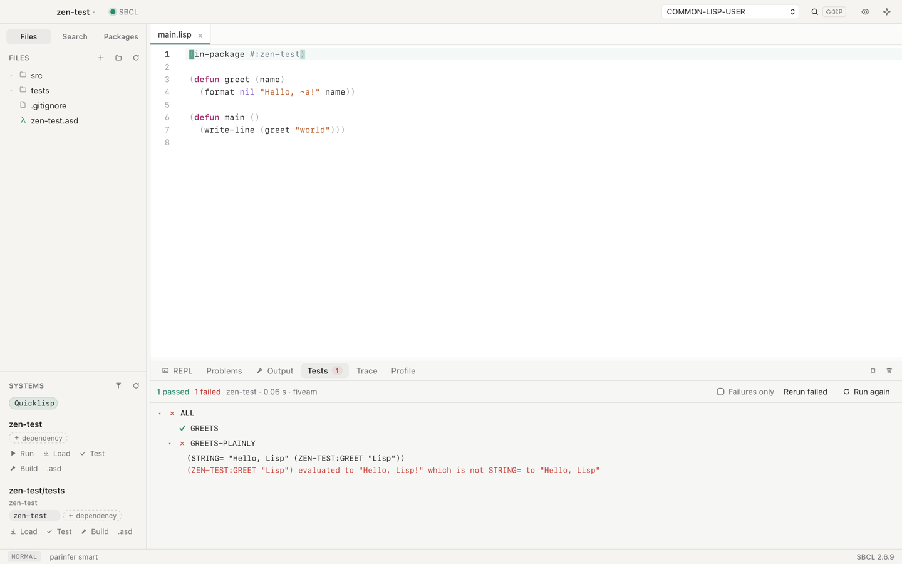
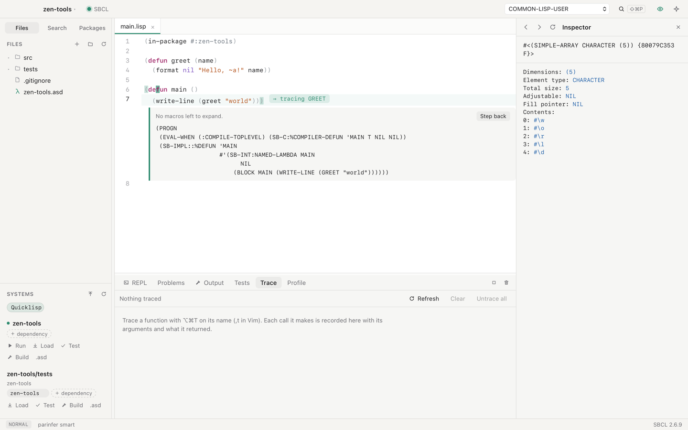
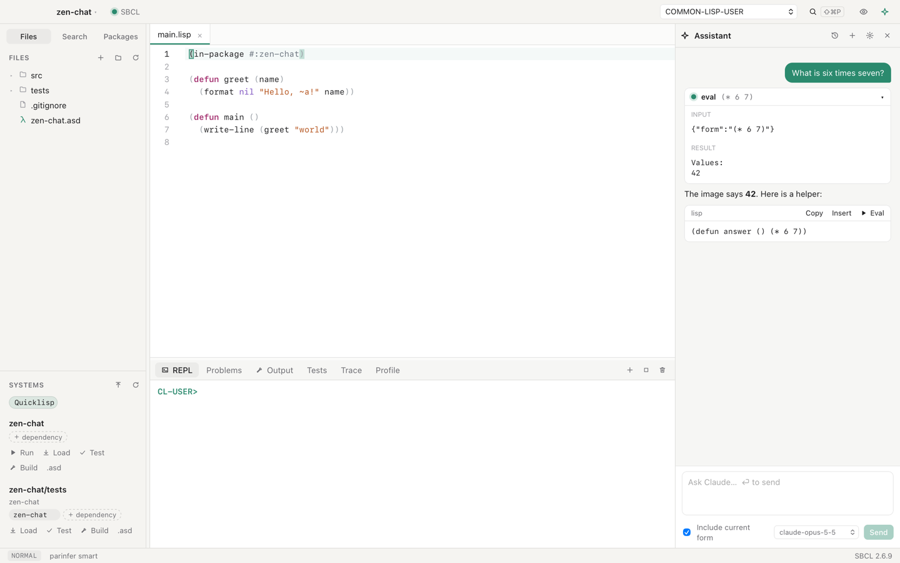
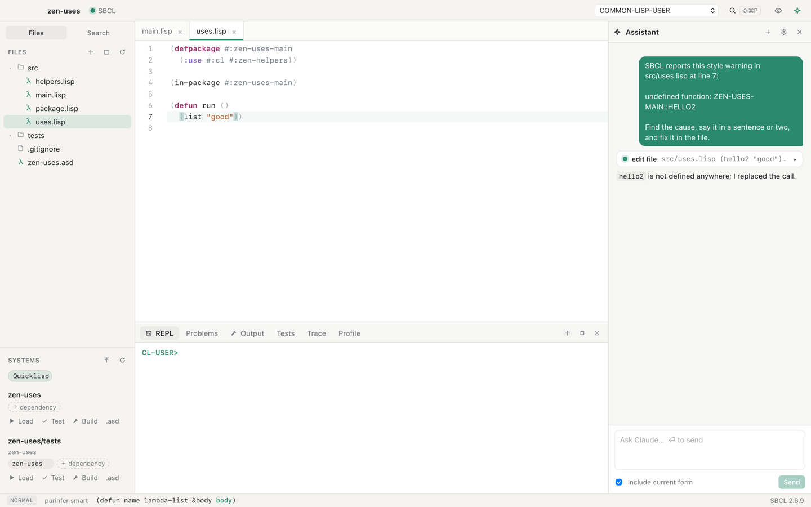
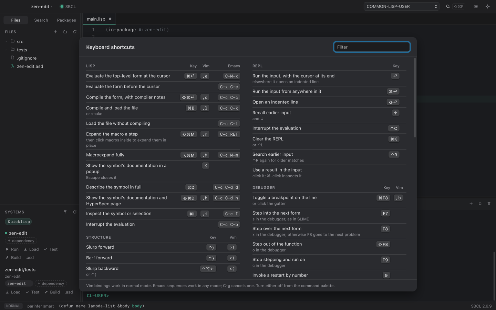
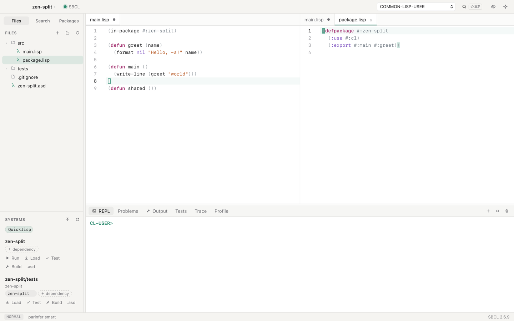
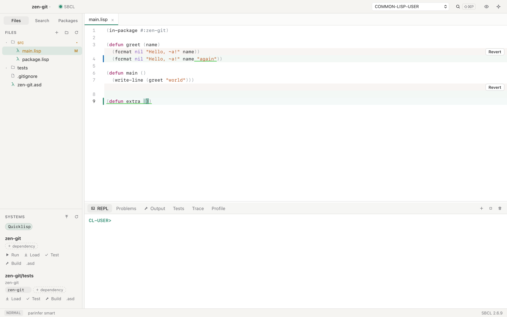
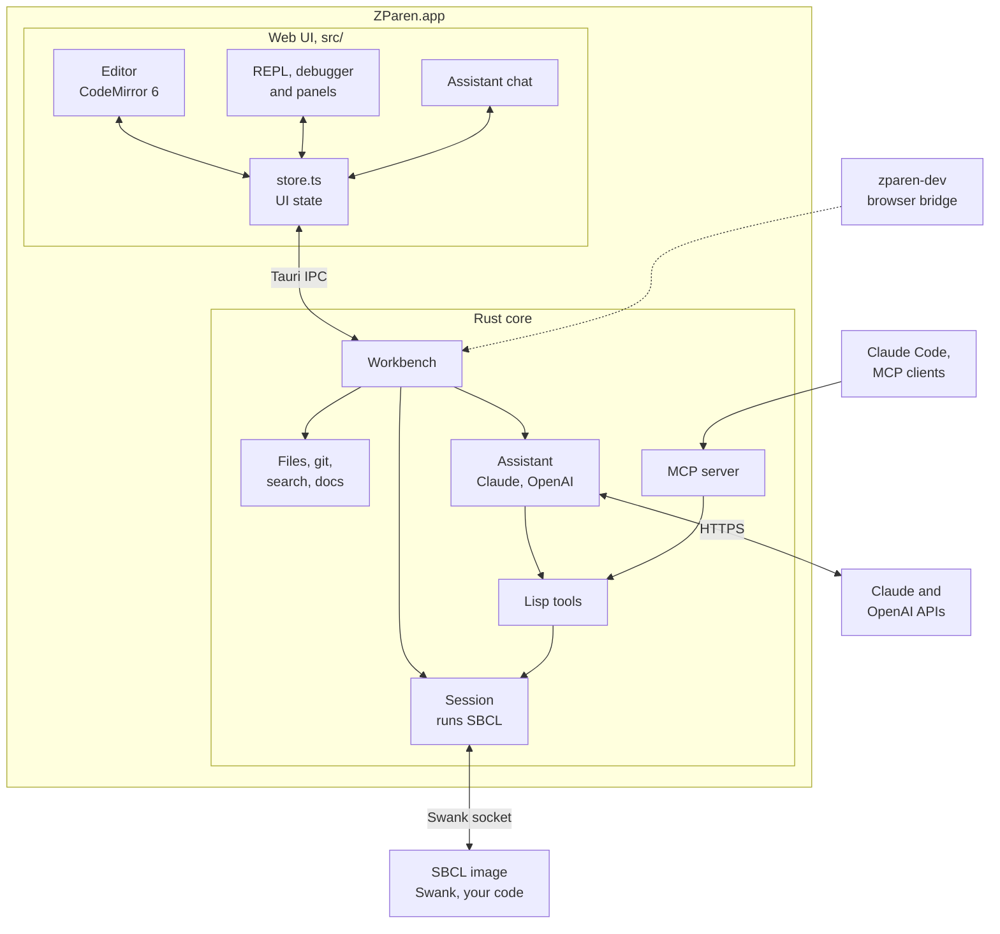

# ZParen

ZParen is a Common Lisp IDE for macOS, built on SBCL. You work in one live
image: evaluate a form, click the result to inspect the real object, stop in
the debugger, fix the code, and restart the frame that failed.
Claude and Codex can work in the same image, from the built-in assistant or
over MCP.



## Why I made it

I am very interested in Common Lisp. But I found it hard to set up Emacs or Vim
so that they are easy to use for Lisp. After an upgrade, I often had to find
the cause of strange errors, and that was frustrating.

So I decided to make an IDE that works the way I like.

## Claude Code helped me build it in a weekend

I subscribe to Claude Code, so I used it to build ZParen from scratch.

I used pstack and told Claude Code to "create an IDE to edit, debug and manage
Common Lisp projects". That is a shorter version of what I wrote.

After some experiments, I also chose Rust and Tauri for the app.
Some people may ask why I did not write all of it in Lisp. In my opinion, it is
better to use the right tool for each job.

### Skills and agents involved

With pstack's `/pstack:poteto-mode`, Claude Code kept working while I slept.
It loaded these skills while it built ZParen:

| Skill | What it was used for |
| --- | --- |
| `pstack:poteto-mode` | The working mode: playbooks for features and bug fixes, and the principles below |
| `figure-it-out` | Planning the large multi-phase build-out |
| `feature` playbook | Each new feature, starting from its data shape |
| `show-me-your-work` | The decision trail kept during long autonomous runs |
| `technical-writing` | This README, the docs and the commit messages |
| `no-comments` | Keeping only comments that explain a non-obvious why |
| `claude-api` | The built-in assistant's Anthropic API client, model and streaming |
| Principles | `prove-it-works`, `foundational-thinking`, `model-the-domain`, `experience-first`, `exhaust-the-design-space`, `sequence-verifiable-units`, `laziness-protocol`, `build-the-lever`, `boundary-discipline`, `test-behavior-not-implementation`, `never-block-on-the-human` |


Subagents took on separate pieces. Each coding agent worked in its own git worktree:

| Agent | Work |
| --- | --- |
| `pstack:poteto-agent` | The SLIME-compatible indentation engine, paredit-style structural editing, the parinfer wasm crate, and the MCP server with its shared tool registry |
| `pstack:comment-sicko` | A pass that removed comments restating the code |
| `Explore` | Research into the UX of other Lisp IDEs |
| `general-purpose` | Side tasks, including an independent review of the decision trail |


## The experience I wanted

1. Vim keys come first.
2. Emacs keys that make Lisp easy to edit.
3. An AI assistant from the first day.
4. MCP, so that external AI tools can work with ZParen.
5. Helpful tools.
6. Quicklisp, ocicl and qlot to manage packages.

## What ZParen does

- **REPL and inspector.** Results are live objects. Click one to use it in the
  next input, or ⌘-click it to inspect it. ⌃R searches earlier input. Extra REPLs run
  in their own threads.
- **Debugger.** Restarts, backtrace, frame locals, restart a frame, form
  breakpoints and stepping.
- **Checking as you type.** Each file is compiled in the background, without
  loading it, and warnings mark the exact symbol. Saving compiles only the
  top-level forms that changed into the running Lisp. A loaded file changed by
  git or another editor is compiled the same way.
- **Navigation.** `gd` goes to local bindings first, then to Lisp's own record
  of a definition, then to definitions in code not loaded yet. ⌃O goes back.
- **Tools.** Trace and Profile panels, macroexpansion in place, disassembly,
  and a test runner for FiveAM, Parachute and Rove.
- **Documentation.** A Docs panel with argument lists, docstrings, apropos and
  the HyperSpec.
- **Projects.** ASDF systems with Quicklisp, qlot, ocicl or vendored
  dependencies, a dependency editor, and startup images.
- **Coalton.** New Coalton projects, Coalton forms in the REPL and the editor,
  `.coal` files, Coalton types on hover, and type errors on the expression
  Coalton blames.
- **Editor.** Vim keys, SLIME's Emacs sequences, parinfer, structural editing,
  split panes, a git gutter with inline diffs, word wrap (⌥Z), Markdown preview
  (⇧⌘V), and a choice of editor and interface fonts.
- **Completion.** Completion offers package and system names where code names
  them, such as `(:use #:alexan`. ⌃N and ⌃P move through the list. `K` shows a
  symbol's documentation in a popup.
- **Themes.** Solarized, Nord and Gruvbox come built in, picked separately for
  light and dark. Your own themes are JSON files in the themes folder, which
  Settings opens.
- **Plugins.** Lisp files in the plugins folder add commands with keys,
  checks, settings, and hooks on saving, loading, tests, the debugger and the
  REPL. See [docs/plugins.md](docs/plugins.md).
- **Sessions.** A project's next session loads the systems its last one
  loaded, and assistant conversations are kept, listed and continued.
- **Mac app.** Signed releases that carry their own SBCL, and in-app updates.







## Build from the source

You need Node.js, Rust and SBCL. ZParen looks for `sbcl` on `PATH`.
Release builds carry their own SBCL, so they run on Macs without one.

To build and open the app:

```sh
npm install
npx tauri build --bundles app
open target/release/bundle/macos/ZParen.app
```

For development, run `npx tauri dev`.

The first start builds an SBCL core with Swank preloaded and caches it in
`~/Library/Caches/ZParen`. That takes about two seconds. Later starts take
milliseconds, and the core rebuilds by itself when SBCL or the bundled Lisp
files change.

## Work in a project

Open a folder with **Open Project…** (⌘O), or create one with **New Project**
(⇧⌘N). Both are in the File menu, with Open Recent and Close Project, and in the
menu under the project's name in the title bar. Leaving a project with unsaved
files asks to save them first.

A new project has an ASDF system, a test system, and an executable build
target. Its language is Common Lisp or [Coalton](#coalton). It takes its
dependencies from Quicklisp, or from ocicl with each version pinned in
`ocicl.csv`.
To use ocicl, run `brew install ocicl` and `ocicl setup` once.

ZParen finds the dependency manager from the files in the project root:

| Found in the root | Manager | Dependencies come from |
| --- | --- | --- |
| `qlfile` | qlot | `.qlot/setup.lisp`, after **Install Dependencies** runs `qlot install` |
| `ocicl.csv` or `ocicl/` | ocicl | ocicl's runtime, which fetches missing systems as they load |
| `vendor/`, `lib/`, `third_party/`, or `deps/` holding `.asd` files | vendor | those directories, added to the ASDF source registry |
| none of the above | Quicklisp | `~/quicklisp`, `~/.quicklisp`, or Roswell's Quicklisp |

The **Packages** tab lists what the project's systems depend on, with each
one's version, where it comes from and whether it is loaded. It adds and
removes dependencies, updates one (with ocicl or qlot) or all of them, and with
ocicl pins a dependency to any version the registry offers.

qlot and ocicl replace the global Quicklisp, so a project with a `qlfile` or
`ocicl.csv` does not load it.

The **Systems** sidebar lists every system in the project's `.asd` files. Each
has four buttons:

- **Run** loads the system and calls its `:entry-point` in the REPL, the way
  its built program would start.
- **Load** loads the system and fetches its dependencies.
- **Test** runs `asdf:test-system`.
- **Build** runs `asdf:make` in a separate SBCL and streams the output to the
  **Output** panel.

## Coalton

[Coalton](https://coalton-lang.github.io) is a statically typed language that
runs inside Common Lisp. ZParen edits, checks and runs Coalton code in the same
live image as Lisp code.

To start a Coalton project:

1. Choose **New Project**, then choose **Coalton** in the **Language** row.
2. Choose **Create**. A Coalton project always uses ocicl, so set up ocicl first.
3. Wait for the first open to finish. ocicl downloads Coalton, and ASDF
   compiles it. This takes some minutes, and later opens use the compiled files.

The new project keeps its code in `src/main.ct`, Coalton's own file type. Its
`.asd` names `"coalton"` and `"coalton-asdf"` in `:defsystem-depends-on`, and
lists `main` as a `:ct-file`. Quicklisp's Coalton is from 2024 and cannot read
`.ct` files, so the dialog does not offer Quicklisp for Coalton.

In the editor and the REPL:

- **Run Coalton forms.** ⌘Enter on a `(coalton-toplevel …)` block compiles it.
  A definition typed alone, such as `define`, `declare` or `define-type`, runs
  inside `coalton-toplevel`. An expression typed alone, such as `match` or
  `let`, runs inside `coalton`.
- **See types.** Hover and `K` show the Coalton type of a name, such as
  `∀ :A. NUM :A ⇒ :A → :A`.
- **Fix type errors.** The check as you type, ⌘Enter, and a file compile mark
  the expression Coalton blames. The note shows Coalton's message without its
  copy of the source. **Copy** and **Ask AI to fix** give the full message.
  A type error in a form typed in the REPL prints Coalton's message in the
  REPL, and the debugger stays closed.
- **Color.** Coalton's operators, such as `define`, `match` and `declare`, have
  their own color. ZParen reads `.ct` and `.coal` files as Lisp source.

Coalton also has the `.coal` file type. A `.coal` file starts with a
`(package …)` form, and its definitions follow without `coalton-toplevel`. An
`.asd` lists such a file as a `:coalton-file`. ZParen compiles a `.coal` file
with Coalton's own compiler:

- ⌘B compiles and loads the file.
- Saving a loaded `.coal` file compiles all of it again.
- The check as you type marks the expression Coalton blames.
- The `(package …)` form sets the package for ⌘Enter, hover and completion.

Save a startup image after the first load. Lisp then starts with Coalton
loaded, and does not compile it again.

Some limits apply:

- When a file compile finds a type error, the forms after it in the file do
  not load.
- When a `.coal` file has a type error, no part of it loads.

## Use Claude or OpenAI

Open the assistant with ⌘L. It answers with Claude or with OpenAI. The model
menu under the chat switches between them, even mid-conversation. Settings ▸
Assistant sets the model for each provider. The defaults are `claude-opus-5-5`
and `gpt-6.1-sol`, and you can type any other model name. **Stop** ends a reply
and any Lisp code the assistant was running for it.

Each provider needs an API key, which you can paste in the assistant. For
Claude, ZParen also uses `ANTHROPIC_API_KEY`, `ANTHROPIC_AUTH_TOKEN`, or an
`ant auth login` profile. For OpenAI, it uses `OPENAI_API_KEY`. Set
`OPENAI_BASE_URL` to use another server that offers the Responses API.

Both providers use the same tools as the MCP server below. Code proposed in a
reply has **Insert** and **Eval** buttons.



To let Claude Code work in your image, register ZParen's MCP server once:

1. Open the assistant with ⌘L.
2. Click the gear icon at the top of the assistant panel.
3. Under **Use Claude Code with this image**, click **Copy command**.
4. Paste the command in a terminal and run it.

The command looks like this, with your token in place of `<token>`:

```sh
claude mcp add --transport http zparen http://127.0.0.1:7337/mcp --header "Authorization: Bearer <token>"
```

The token is a password that ZParen makes the first time its MCP server
starts. The server listens only on `127.0.0.1` and refuses any request
without the token, so other programs on your Mac cannot run code in your
image. The token stays the same each time ZParen starts, so you register only once.
It lives in `~/Library/Application Support/ZParen/mcp-token`, which only your
user can read. If you remove that file, ZParen makes a new token, and you
must register again. Keep the token out of chats and repositories.

The tools are `eval`, `compile_form`, `describe_symbol`, `apropos`,
`find_definitions`, `who_calls`, `macroexpand`, `list_packages`,
`project_info`, `load_system`, `run_tests`, `debugger_state`,
`invoke_restart`, `read_file`, `edit_file`, and `list_files`.

Every warning and error mark has an **Ask AI to fix** button. It shows in the
hover box and in the box that opens when the cursor reaches a mark. It sends
SBCL's message, the file, the line and the code to the assistant. The assistant
finds the cause and changes the file with `edit_file`. The
change shows in the editor at once, and one undo takes it back.



## Keys

Press ⇧⌘/ for every shortcut, with a filter. The list comes from the same
table that defines the bindings, so it is always current.



These are the ones you use most:

| Action | Shortcut | Vim |
| --- | --- | --- |
| Evaluate the form at the cursor | ⌘↩ | `,e` |
| Compile the form, with compiler notes | ⇧⌘↩ | `,c` |
| Compile and load the file | ⌘B | `,l` |
| Go to definition, find references | F12, ⇧F12 | `gd`, `gr` |
| Go back, go forward | ⌃O, ⌃⇧O | same in Vim |
| Slurp, barf | ⌃), ⌃} | `>)`, `<)` |
| Select a form | ⌃⇧⌘→ | `vaf` |
| Search in project | ⇧⌘F | |
| Command palette | ⇧⌘P | |

SLIME's Emacs sequences work too, in any Vim mode:

| Sequence | Action |
| --- | --- |
| `C-x C-e` | Evaluate the form before the cursor |
| `C-M-x` | Evaluate the top-level form |
| `C-c C-c` | Compile the top-level form |
| `C-c C-k` | Compile and load the file |
| `M-.`, `M-,` | Go to a definition, and back |
| `C-c C-z` | Switch to the REPL |

The status bar shows a prefix such as `C-c` while you type it, and `C-g`
cancels it. ⌘J goes to the REPL, and from the REPL back to the editor.
Plugin commands list their keys in the same ⇧⌘/ screen.

Hover a symbol to see its documentation, or its argument list when it has
none. Turn off Vim keys, Emacs sequences, parinfer or checking as you type in
Settings (⌘,).

## Edit code

Parinfer keeps parentheses balanced as you type, and typing `(` or `"` over
a selection wraps it. The structural commands move code by whole forms:
slurp, barf, raise, splice, kill, transpose, split, and join. In Vim,
`af`, `if`, `aF`, and `iF` select a form, its inside, or the whole top-level
form, so `daf` and `cif` work as you would expect.

The file tree creates, renames, and moves files to the Trash. When another
program changes an open file, ZParen reloads it if you have no unsaved
edits, and asks otherwise. It also asks before closing a file or quitting
with unsaved changes. Files outside the project are read-only and show a lock.
SBCL's own sources, which go to definition can open, are an example.

**Search** in the sidebar finds and replaces across the project, with the
same `.gitignore` rules as ripgrep. The **Problems** panel lists compiler
notes from every file. The trash button in the bottom panel clears whichever
tab is showing.





## Architecture



The UI never talks to Lisp directly. It sends typed requests to the Workbench
in Rust and renders the events that come back. The TypeScript types for both
are generated from the Rust ones into `src/protocol`.

The Workbench owns one SBCL process and talks to it over Swank, the protocol
SLIME uses. ZParen's own Lisp code in `resources/lisp` loads into that image
beside Swank, and so do your project and your plugins.

The assistant and outside agents reach the image through the same tools, so
what they evaluate is what you see in the REPL. In development, `zparen-dev`
serves the same Workbench over a WebSocket. That lets the UI run in a browser,
where the end-to-end tests drive it. [How ZParen is built](docs/architecture.md)
explains why it is designed this way.

## Develop

`scripts/verify.sh` runs every check: the Rust tests against a real SBCL, the
parinfer wasm tests, the TypeScript tests, and the WebKit end-to-end tests.
Add `--network` to include the ocicl test, which downloads from `ghcr.io`.

To run the UI in a browser against a real SBCL, start the bridge and Vite:

```sh
cargo run -p zparen-dev
npx vite --port 1420
```

Set `ZPAREN_TRACE=1` to log every Swank message.

## Release

`scripts/release.sh` builds `ZParen.app` and its disk image, signs both with
a Developer ID, and checks the signatures. The app carries a copy of the
installed SBCL (`scripts/bundle-sbcl.sh`), so it runs on Macs without SBCL. That
copy is signed with the hardened runtime and the entitlements SBCL needs to
compile code.

```sh
security find-identity -v -p codesigning            # pick a Developer ID Application identity
ZPAREN_SIGN_IDENTITY="Developer ID Application: …" scripts/release.sh
```

To notarize, save notarytool credentials once, then pass the profile:

```sh
xcrun notarytool store-credentials zparen --apple-id you@example.com --team-id TEAMID
ZPAREN_SIGN_IDENTITY="…" NOTARY_PROFILE=zparen scripts/release.sh
```

The script submits the disk image, waits for Apple, and staples the ticket to
the image and the app, so Gatekeeper opens them offline.

To ship updates, make a key pair once with `npx tauri signer generate` and
keep the private half safe. Builds made with the update variables check for a
newer release when they start and from ZParen ▸ Check for Updates…, and install only
archives signed with that key:

```sh
ZPAREN_UPDATE_URL=https://example.com/zparen/latest.json \
ZPAREN_UPDATE_DOWNLOAD=https://example.com/zparen/ZParen.app.tar.gz \
ZPAREN_UPDATE_PUBKEY="$(cat zparen.key.pub)" TAURI_SIGNING_PRIVATE_KEY="$(cat zparen.key)" \
ZPAREN_SIGN_IDENTITY="…" scripts/release.sh
```

The script writes `latest.json` beside the archive. Publish both at those
URLs. A build without these variables has updates turned off and says so.

## Learn more

[How ZParen is built](docs/architecture.md) explains the design.
[What ZParen borrows from TurboLisp](docs/inspiration.md) lists the ideas taken
from TurboLisp and WhateverCLIM.

## License

ZParen is MIT licensed. See [LICENSE](LICENSE). It includes Swank from
[SLIME](https://github.com/slime/slime) in `resources/swank`, which is in the
public domain, and the parinfer engine from
[parinfer-rust](https://github.com/eraserhd/parinfer-rust) in
`crates/parinfer-wasm`, which is ISC licensed.
